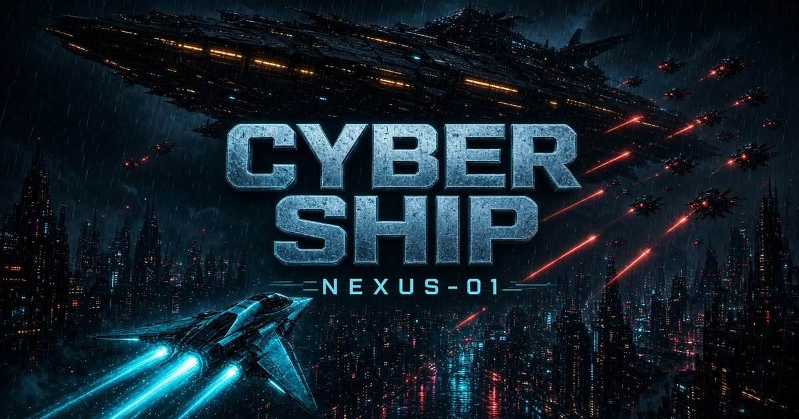

# CyberShip

Spillbar cyberpunk shoot 'em up. Tre bølger, så bossen NEXUS-01.

Tilpasset iPhone 17 Pro (402×874, Dynamic Island og hjem-indikator). Skipet styres med tommelen og holder seg over fingeren. På desktop fungerer WASD og piltaster.

## Skjermbilder

<p align="center">
  
</p>

<p align="center">
  
</p>

## Kjør lokalt

```bash
npm install
npm run dev
```

Åpne adressen som skrives ut. `npm run build` lager produksjonsbygget.
